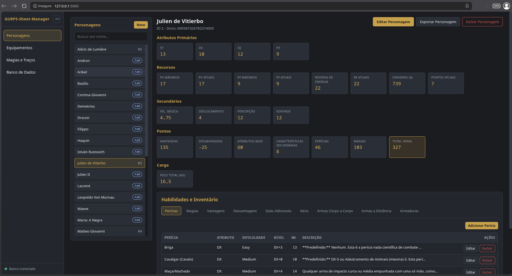
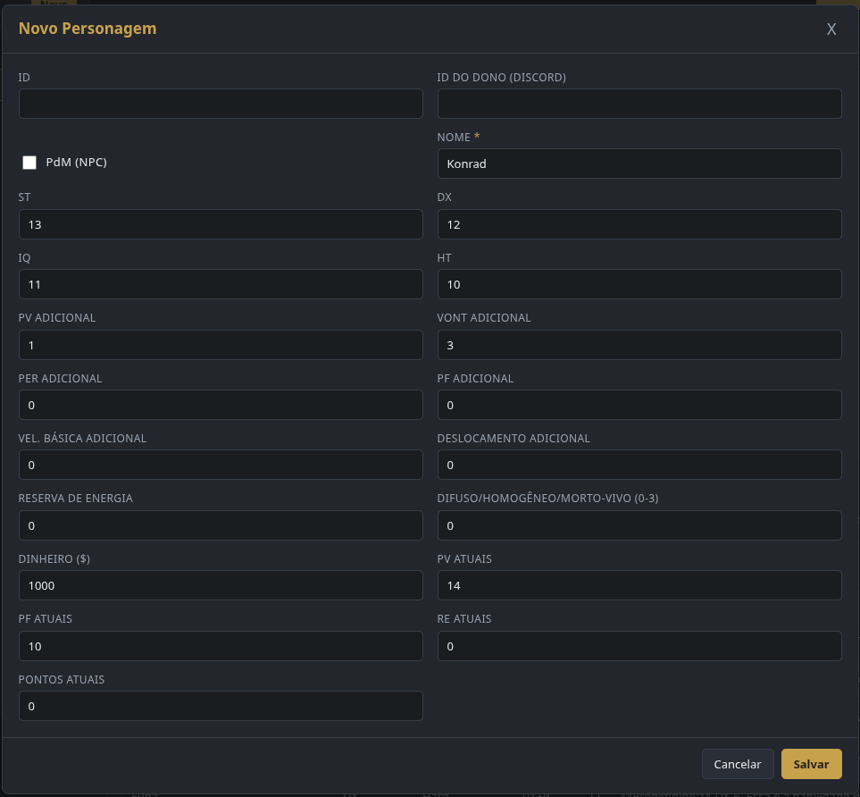
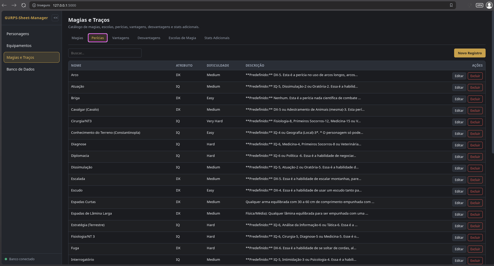
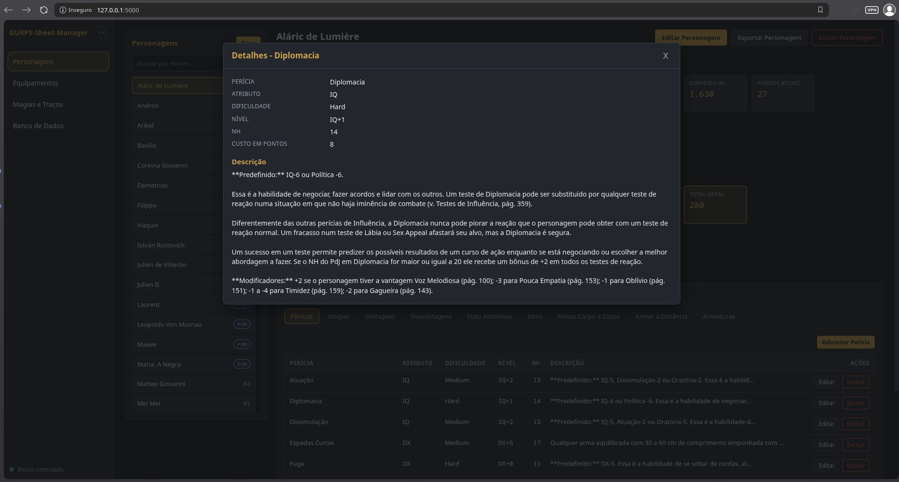
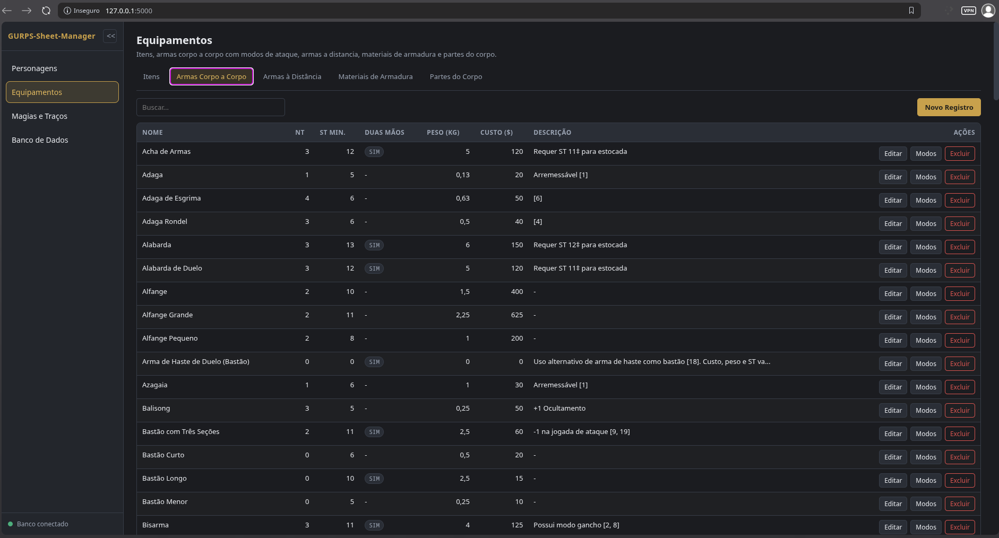
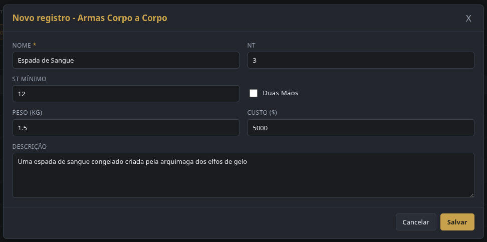

<div align="center">

# GURPS-Sheet-Manager

**Gestão completa de fichas de GURPS — e a principal ferramenta para editar o banco de dados do [Dice-Master](https://github.com/M-G-Bitencourt/Dice-Master).**

[](https://www.python.org/)
[](https://flask.palletsprojects.com/)
[](https://www.sqlite.org/)
[](https://weasyprint.org/)
[](https://github.com/M-G-Bitencourt/Dice-Master)
[](LICENSE)



</div>

## Visão geral

O **GURPS-Sheet-Manager** é uma aplicação web local para criar, consultar e gerenciar fichas de personagem de GURPS. Em uma única interface, você reúne atributos, recursos, perícias, magias, vantagens, desvantagens, equipamentos e inventário — com cálculos automáticos de pontos, carga e estatísticas derivadas.

Os dados ficam em um banco **SQLite** que você pode escolher, criar ou trocar a qualquer momento. Sem conta, sem servidor externo: tudo roda na sua máquina e permanece sob seu controle.

Além das fichas, o GURPS-Sheet-Manager é a **principal ferramenta para editar o banco de dados do [Dice-Master](https://github.com/M-G-Bitencourt/Dice-Master)**, o bot de Discord que automatiza rolagens, cálculos de dano e o acompanhamento de personagens durante as sessões de GURPS.

## Funcionalidades

- **Fichas completas** — ST, DX, IQ, HT, PV, PF, reserva de energia, velocidade, deslocamento, percepção, vontade, dinheiro e pontos atuais.
- **Cálculos automáticos** — estatísticas derivadas, custo de perícias e magias por nível relativo e total de pontos da ficha.
- **Perícias e magias** — catálogo com atributo, dificuldade, nível, NH e descrição; vínculo por personagem com nível relativo.
- **Vantagens e desvantagens** — custo em pontos, descrição e anotações específicas de cada personagem.
- **Stats adicionais** — campos extras configuráveis e valores individuais por ficha.
- **Efeitos de combate** — catálogo global com tipos ativos e passivos, alvos, valores, usos por turno e vínculo por personagem; edições no catálogo são retroativas aos vínculos.
- **Equipamentos** — itens, armas com modos de ataque corpo a corpo e à distância (perícia, dano estruturado, divisor de armadura, alcance e cadência), materiais de armadura e partes do corpo.
- **Inventário** — quantidades, itens equipados, munição atual e armaduras por parte do corpo e camada.
- **Catálogos reutilizáveis** — cadastre um equipamento, perícia ou magia uma vez e reutilize em qualquer personagem.
- **Exportação em PDF** — gere a ficha completa em PDF com um clique.
- **Múltiplos bancos de dados** — abra, crie e alterne entre arquivos SQLite; o app valida o esquema e mantém a lista de recentes.
- **Duplicação de fichas** — copie um personagem com todos os vínculos: perícias, magias, vantagens, desvantagens, efeitos de combate, itens, armas e armaduras.
- **Proteção contra duplicidade** — validação de registros repetidos nos catálogos.
- **Integração com Dice-Master** — abre e edita o mesmo banco SQLite do bot de Discord [Dice-Master](https://github.com/M-G-Bitencourt/Dice-Master), sendo a principal ferramenta para gerenciar personagens, perícias, magias, equipamentos e inventário usados nas sessões.

## Integração com Dice-Master

O [Dice-Master](https://github.com/M-G-Bitencourt/Dice-Master) é um bot de Discord para GURPS que automatiza rolagens, cálculos de dano e o acompanhamento de fichas durante as sessões. O GURPS-Sheet-Manager é a **principal ferramenta para editar o banco de dados utilizado por ele**.

Na aba **Banco de Dados**, selecione o arquivo SQLite do Dice-Master para gerenciar personagens, perícias, magias, vantagens, desvantagens, equipamentos e inventário com uma interface visual, sem precisar editar o banco manualmente. O esquema do arquivo é validado antes da abertura, evitando alterações em bancos incompatíveis.

O esquema atual é a **versão 13** (`PRAGMA user_version = 13`). Bancos de versões anteriores não são migrados nem aceitos; crie ou selecione um banco novo. As tabelas `weapons` e `weapon_modes` unificam armas e modos de ataque, `character_weapons` guarda os vínculos de inventário e `damage_types` define os tipos de dano. As tabelas de estado em tempo real do Dice-Master (`combat_sessions`, `pending_attacks`, `combat_participants`, `combat_log`) são apenas validadas pelo gerenciador. Já o catálogo `combat_effects` e os vínculos `character_combat_effects` são editáveis na aba **Magias e Traços** e na ficha do personagem.

Efeitos passivos (`st`, `dx`, `iq`, `ht`, `max_pv`, `max_pf`, `will`, `per`, `basic_speed`, `basic_move`, `ht_check` e `rd`) não consomem usos por turno e afetam somente o combate do Dice-Master. A ficha e o admin continuam exibindo os valores base do personagem.

## Telas

### Cadastro de personagem

Formulário completo para criar e editar fichas, com atributos, recursos, dinheiro e pontos iniciais.

<p align="center">
  
</p>

### Perícias e traços

O catálogo centraliza perícias, magias, vantagens, desvantagens, escolas de magia e stats adicionais. Na ficha, cada perícia exibe atributo, dificuldade, nível relativo, NH e descrição detalhada.

<table>
  <tr>
    <td width="50%" valign="top">
      
      <p align="center"><sub>Catálogo de perícias, magias, vantagens e desvantagens</sub></p>
    </td>
    <td width="50%" valign="top">
      
      <p align="center"><sub>Detalhes e modificadores de uma perícia na ficha</sub></p>
    </td>
  </tr>
</table>

### Equipamentos

Itens, armas com modos corpo a corpo e à distância, materiais de armadura e partes do corpo ficam disponíveis em catálogos próprios, com cadastro e edição por formulário.

<table>
  <tr>
    <td width="50%" valign="top">
      
      <p align="center"><sub>Catálogo de equipamentos e armas</sub></p>
    </td>
    <td width="50%" valign="top">
      
      <p align="center"><sub>Cadastro de uma nova arma</sub></p>
    </td>
  </tr>
</table>

## Tecnologias

| Camada | Tecnologia |
| --- | --- |
| Backend | Python + Flask |
| Banco de dados | SQLite |
| Frontend | HTML, CSS e JavaScript puro (ES Modules) |
| Exportação | WeasyPrint (HTML → PDF) |
| API | REST com respostas JSON |

## Como executar

### Pré-requisitos

- Python 3.9 ou superior
- pip

### Instalação

```bash
git clone https://github.com/M-G-Bitencourt/GURPS-Sheet-Manager.git
cd GURPS-Sheet-Manager

python -m venv .venv
source .venv/bin/activate  # Windows: .venv\Scripts\activate

pip install -r requirements.txt
```

### Iniciar a aplicação

```bash
python run.py
```

O navegador abre automaticamente em `http://127.0.0.1:5000/`. Por padrão, o banco de dados é criado e usado em `data/database.db`.

### Opções de linha de comando

| Opção | Descrição |
| --- | --- |
| `--host` | Endereço de escuta (padrão: `127.0.0.1`) |
| `--port` | Porta do servidor (padrão: `5000`) |
| `--database CAMINHO` | Abre um banco existente ou cria um novo no caminho indicado |
| `--no-browser` | Não abre o navegador automaticamente |

## Estrutura do projeto

```text
.
├── app.py                 # Fábrica da aplicação Flask
├── run.py                 # Ponto de entrada e configuração do banco
├── api/                   # Rotas REST, CRUD genérico e exportação em PDF
├── database/              # Conexão SQLite, validação de esquema e preferências
├── data/                  # init.sql e banco padrão (gerado em tempo de execução)
├── static/                # Interface web (HTML, CSS e JavaScript)
├── templates/             # Template HTML da ficha exportada em PDF
├── tests/                 # Testes de esquema e da API
├── git-assets/            # Imagens usadas neste README
├── requirements.txt
└── LICENSE
```

## API

Endpoints principais:

| Método | Rota | Descrição |
| --- | --- | --- |
| `GET` | `/api/health` | Verificação de saúde da aplicação |
| `GET` | `/api/schemas` | Metadados dos recursos e relações da interface |
| `GET` / `POST` | `/api/characters` | Lista e cria personagens |
| `GET` / `PUT` / `DELETE` | `/api/characters/<id>` | Consulta, atualiza e exclui um personagem |
| `GET` | `/api/characters/<id>/details` | Retorna a ficha agregada com cálculos |
| `POST` | `/api/characters/<id>/duplicate` | Duplica a ficha e todos os vínculos do personagem |
| `GET` / `POST` | `/api/characters/<id>/<relação>` | Lista e vincula itens à ficha |
| `PUT` / `DELETE` | `/api/characters/<id>/<relação>/<id>` | Atualiza e desvincula itens da ficha |
| `GET` | `/api/characters/<id>/export` | Exporta a ficha completa em PDF |
| `GET` / `POST` | `/api/weapons/<id>/modes` | Lista e cria modos de ataque de uma arma |
| `GET` | `/api/damage-types` | Lista os tipos de dano com rótulos em pt-BR |
| CRUD | `/api/<recurso>` | Catálogos (itens, armas, perícias, magias etc.) |
| `GET` | `/api/database` | Estado do banco ativo e lista de recentes |
| `POST` | `/api/database/select` · `/create` · `/reset` · `/browse` | Seleciona, cria, restaura ou localiza bancos de dados |

## Licença

Distribuído sob a **GNU Affero General Public License v3.0 (AGPL-3.0)**. Consulte o arquivo [LICENSE](LICENSE) para mais detalhes.

---

<div align="center">
  <sub>Feito para a comunidade GURPS. Que seus personagens sobrevivam à próxima sessão.</sub>
</div>
